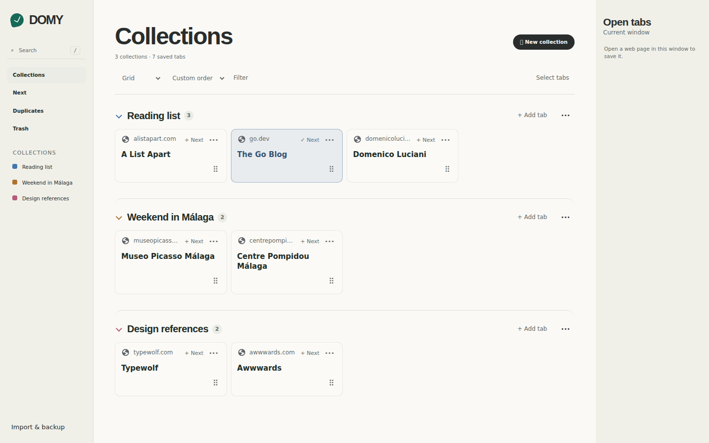

# DOMY

DOMY turns the new tab page in Brave into a personal collection of saved links. Drag an open tab into a collection, save a whole window, or reopen a collection when you return to a project. Your workspace is stored locally in your browser profile.

## Install

1. Download the DOMY ZIP from the [latest release](https://github.com/dlion/domy/releases/latest) and extract it to a folder you plan to keep.
2. Open `brave://extensions` and enable **Developer mode**.
3. Click **Load unpacked** and select the extracted directory containing **manifest.json**.
4. Open a new tab. Use **New collection** to create your first collection, then drag a page from **Open tabs** into it.

If you install from a Git clone, select the **extension** directory instead.

If you already use DOMY from another folder, export your backup first. After loading the clone, use **Import & backup → Restore backup** to bring your workspace across.

## Organize your links

- Choose Grid, Cards, List or Compact and filter by tag or collection color.
- Use the drag handle to move a saved link. Click its title to open it.
- Press **/** to search saved titles and URLs, or switch the search to collections.
- Add individual links to **Next**, set their order, and mark them done to keep a dated history.
- Review duplicate URLs across collections and restore deleted items from Trash.
- Import Toby v3 JSON exports or export a DOMY backup.

## Run the behavior tests

With Node.js 22.12 or newer, run `node --test tests/*.mjs` from the repository root. The scenarios exercise the same model used by the extension.

Created by [Domenico Luciani](https://domenicoluciani.com). Released under the [MIT License](LICENSE).
